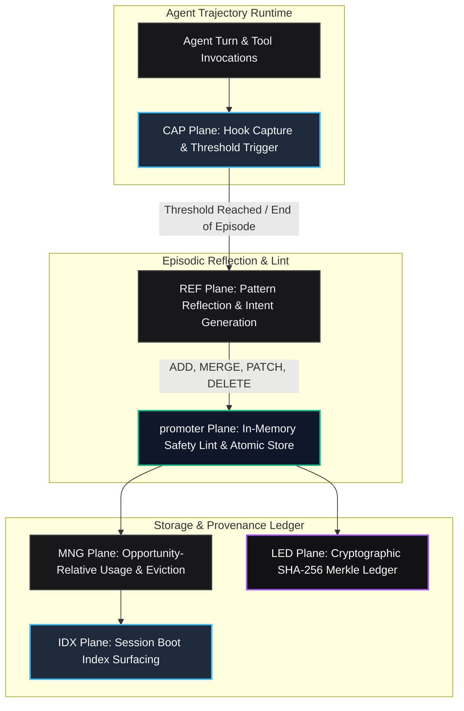

# Apex Growth Systems LLC
# AutoHarness Self-Learning Engine Specification
## Formal Protocol Architecture: CAP, REF, promoter, IDX, MNG, and LED Planes

---

### 1. Architectural Philosophy

Classical software engineering agents operate with episodic amnesia. When an agent discovers how to configure a repository test suite, isolate a fixture bug, or mock a flaky network service, that knowledge vanishes the moment the turn terminates. In subsequent episodes, the agent repeats identical exploratory bash commands, burning between \$15.00 and \$60.00 per task in redundant reasoning tokens.

**AutoHarness** solves this by establishing a decentralized, 6-plane continuous skill lifecycle based on the proven architecture that elevated Hermes Agent to state-of-the-art SWE harness benchmark performance.

---

### 2. The 6-Plane Lifecycle Architecture

---

### 3. Detailed Plane Specifications

#### 1. CAP Plane (Capture Hook)
- **Role**: Intercepts tool calls, arguments, stdout/stderr streams, and latency metrics without blocking execution.
- **Trigger**: When cumulative turn events reach the reflection threshold (default: 5 turns) or when the episode concludes.
- **Output**: Immutable `EpisodeTrace` containing ordered `TurnEvent` records.

#### 2. REF Plane (Reflection)
- **Role**: Evaluates the `EpisodeTrace` against existing repository knowledge and synthesizes structured mutations:
  - `ADD`: Creates a new repository-specific test recipe or bug-fix template.
  - `MERGE`: Fuses overlapping skills (> 60% trigger overlap) into a generalized pattern.
  - `PATCH`: Modifies an existing skill when repository assumptions fail.
  - `DELETE`: Prunes counter-productive or degraded heuristics.
- **Output**: List of typed `SkillIntent` objects with empirical rationale.

#### 3. promoter Plane (Validation & Storage)
- **Role**: The exclusive write gateway to the skill library.
- **In-Memory Safety Linting**:
  - Validates schema completeness (name, scope, triggers, steps).
  - Enforces safety guardrails: rejects destructive shell commands (`rm -rf`, `mkfs`, fork bombs).
- **Atomic Persistence**: Executes atomic rename into `.apex/skills/` or in-memory virtual registry.

#### 4. IDX Plane (Surfacing)
- **Role**: Injects a compact markdown summary table of active skills at session start.
- **Token Efficiency**: Keeps prompt index overhead below 500 tokens.
- **Trigger Matching**: Ranks skills by scope match, trigger keywords, and historical confidence.

#### 5. MNG Plane (Lifecycle & Capacity Manager)
- **Role**: Prevents context bloating and memory saturation.
- **Metric**: Opportunity-Relative Usage Rate:
  $$\text{Usage Rate} = \frac{\text{Loads}}{\text{Sessions Since Creation}}$$
- **Bounded Eviction**: When total skills exceed the configured capacity cap (e.g. 50 skills), automatically evicts the lowest-rate skills.

#### 6. LED Plane (Provenance Ledger)
- **Role**: Tamper-evident cryptographic verification of skill origins.
- **Format**: SHA-256 hash chain linking every skill version directly back to the episode ID and execution evidence that spawned it.
